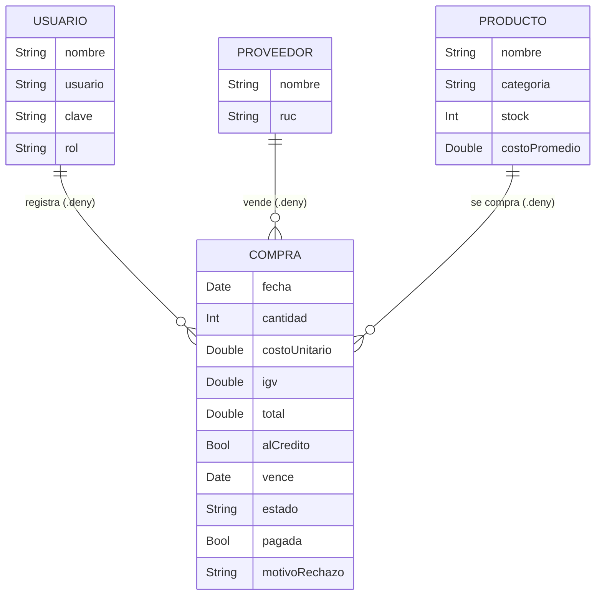

# Expediente del trabajo · Compras Tecsup (Grupo B)

## 1. Integrantes y caso

| | |
|---|---|
| Integrantes | Anderson Rivera · _(compañero/a)_ |
| Grupo | B · Caso Compras |
| Tecnología | SwiftUI + SwiftData |
| App | **Compras Tecsup** (nombre corto bajo el ícono: *Compras*) |

## 2. Modelo de datos

| Clase @Model | Propiedades (tipo) | Relaciones (delete rule) |
|---|---|---|
| **Usuario** | nombre, usuario, clave, rol (String) | compras: [Compra] (.deny, inverse \Compra.comprador) |
| **Proveedor** | nombre, ruc (String) | compras: [Compra] (.deny, inverse \Compra.proveedor) |
| **Producto** | nombre, categoria (String) · stock (Int) · costoPromedio (Double) | compras: [Compra] (.deny, inverse \Compra.producto) |
| **Compra** | fecha (Date) · cantidad (Int) · costoUnitario, igv, total (Double) · alCredito (Bool) · vence (Date) · estado (String: Pendiente, Aprobada, Rechazada) · pagada (Bool) · motivoRechazo (String?) | comprador: Usuario? · proveedor: Proveedor? · producto: Producto? |

**Por qué .deny:** una compra es un documento contable; si se pudiera borrar el proveedor, el producto o el usuario, la compra quedaría sin datos y los totales del resumen cambiarían. Además de declarar `.deny`, la pantalla revisa `compras.isEmpty` antes de borrar y muestra una alerta.

Valores **calculados, no guardados**: subtotal, valor del inventario, total comprado y "por pagar" de cada proveedor, si una compra está vencida.

## 3. Roles y permisos

| Qué puede hacer | Comprador | Supervisor |
|---|---|---|
| Pestañas | Productos, Proveedores, Compra, Mis compras | Resumen, Aprobar, Por pagar, Productos, Proveedores |
| Productos y proveedores | Consultar y buscar | Crear, editar y borrar (bloqueado si tiene compras) |
| Compras | Registrar y ver **solo las suyas** | Aprobar o rechazar, ver todo y **pagar** |
| Cuenta | Menú del avatar con Cerrar sesión | Menú del avatar con Cerrar sesión |

## 4. Reglas de negocio (resueltas a mano)

| Regla | Ejemplo numérico |
|---|---|
| **IGV** = 18 % del subtotal; total = subtotal + IGV. El IGV es crédito fiscal. | 10 × 120.00 = 1,200.00 → IGV 216.00 → total 1,416.00 |
| **Aprobación:** total < S/ 5,000 → Aprobada al instante; desde S/ 5,000 → Pendiente (no cambia stock, costo ni por pagar) | 4,956.00 → Aprobada · 7,080.00 → Pendiente |
| **Costo promedio ponderado** (al aprobar): (stock × costo prom. + cantidad × costo unit.) / (stock + cantidad) | (40 × 110 + 10 × 120) / 50 = **112.00** · (40 × 110 + 50 × 120) / 90 = **115.56** |
| **Stock** sube al aprobar | 40 + 50 = 90 |
| **Contado** queda pagada; **crédito** vence a los 30 días | Compra 03/11 a crédito → vence 03/12 |
| **Vencida:** aprobada, a crédito, sin pagar y con vence < hoy | Compra del 01/10 a crédito, hoy 12/11 → VENCIDA |
| **Pagar** (solo supervisor) la saca de Pendientes de pago | Por pagar 5,369.00 − 1,416.00 = 3,953.00 |
| **Rechazar** exige motivo y no cambia nada más | Stock sigue en 40 |

## 5. Pantallas

| Pant. | Propósito | Lee | Escribe |
|---|---|---|---|
| B1 Login | Entrar con usuario y clave | Usuario (fetch con #Predicate) | Sesión |
| B2 Crear cuenta | Registrar y entrar directo | Usuario (fetchCount para unicidad) | Usuario, sesión |
| B3 Productos | Catálogo y valor del inventario | Producto | Producto (supervisor) |
| B4 Proveedores | Proveedores con total comprado y por pagar | Proveedor y sus compras | Proveedor (supervisor) |
| B5 Nueva compra | Registrar compra con IGV y aviso de aprobación | Proveedor, Producto, sesión | Compra (y Producto si se aprueba al instante) |
| B6 Mis compras | Compras del comprador por estado | Compra (#Predicate por comprador y estado) | — |
| B7 Aprobar | Aprobar o rechazar compras pendientes con vista previa del efecto | Compra pendiente, Producto | Compra, Producto |
| B8 Por pagar | Cuentas por pagar, vencidas y pagadas | Compra (#Predicate por filtro) | Compra.pagada |
| B9 Resumen | Inventario, crédito fiscal, por pagar, por aprobar, total por proveedor | Producto, Compra, Proveedor | — |

## 6. Casos de prueba

Los nueve de la guía (ver README) y dos propios:

| N.º | Caso | Resultado esperado |
|---|---|---|
| 10 | Compra de 35 × 120.00 y luego 36 × 120.00 | 4,956.00 se aprueba al instante; 5,097.60 queda Pendiente (el límite se compara con el total, no con el subtotal) |
| 11 | El supervisor intenta borrar un proveedor con compras | Alerta "No se puede borrar"; el proveedor sigue en la lista |

## 7. Plan de commits

1. Expediente (rama main).
2. Modelo de datos: las 4 clases @Model y ModelContainerProvider.
3. Registro, login, sesión y pestañas por rol (B1, B2).
4. Productos y proveedores con permisos por rol (B3, B4).
5. Nueva compra con IGV, aprobación y costo promedio (B5).
6. Mis compras con #Predicate por comprador (B6).
7. Aprobar y rechazar con motivo (B7).
8. Por pagar con filtros, VENCIDA y pagar (B8).
9. Resumen del supervisor (B9).
10. Ícono, capturas y PROMPTS.md final.

## 8. Plan de uso de IA

- **Se pide a la IA:** estructura del proyecto SwiftUI + SwiftData, las vistas de las 9 pantallas y la armadura de los `#Predicate`.
- **Se hace a mano:** el modelo de datos y sus delete rules, las reglas de negocio con sus ejemplos numéricos y los casos de prueba (este expediente).
- **Cómo se verifica:** se ejecutan los 11 casos de prueba en el simulador y se comparan con los resultados calculados a mano; cada consulta queda anotada en PROMPTS.md con lo que se aceptó o modificó.

## 9. Visto bueno

| Fecha | Docente | Firma / confirmación |
|---|---|---|
| | Juan León | |
